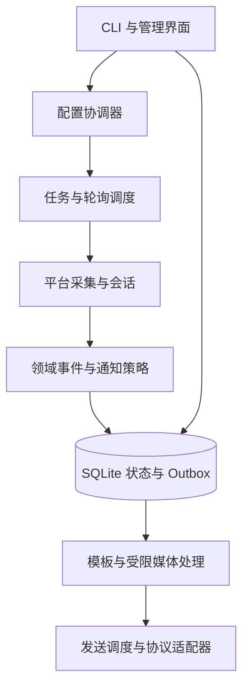

# 新仓库从零开发 Rust 版 DDBOT：可行性与架构建议

日期：2026-11-17。业务参考：DDBOT-WSa `next-dev`，提交 `f06149323ce2462f10eb424ed3780114b8360462`。

本文回应“停止在旧架构上修补，另开仓库，按最佳实践重写”的方案。它是独立产品方案，不代表已经创建新仓库或开始实现。

## 1. 判断：在接受新产品边界的前提下，更推荐这条路线

**如果目标是长期维护的新一代 Rust 产品，并且允许新配置、新模板、新数据库与按批次支持平台，那么从新仓库开发比追求旧项目逐项兼容更合理。**

但“新开仓库”和“不兼容旧行为”必须分开看：

| 前提 | 对成本的影响 |
| --- | --- |
| 只换仓库位置，仍要求全部旧功能、模板、数据、命令和发布目标兼容 | 成本基本不会因为新仓库而降低 |
| 允许新配置、新模板、新数据模型，平台逐步补齐 | 可以省去大量兼容解释器、旧存储语义和双运行时接入工作 |
| 同时收窄平台、适配器、媒体与部署目标 | 首版可以明显提早交付，但功能范围也相应减少 |

下面采用第二种前提，并为首版建议明确范围。这是为了评估方案而提出的假设，尚不是用户已确认的功能删减清单。

推荐把项目定义为“Rust 实现的下一代多平台订阅推送服务”，而不是“现有 Go 程序的语法翻译版”。验收以新的业务契约为准：订阅什么、何时通知、发给谁、失败怎么办、配置何时生效。

## 2. 可以省下什么，什么仍然必须解决

### 可以不继承的实现负担

- Go `text/template` fork、反射、Go 对象方法和带 DB / 文件副作用的模板函数。
- BuntDB 文件格式、goroutine-local 事务以及旧键命名体系的逐项模拟。
- 以 int64 模拟所有平台原始 ID 的设计；新系统可直接保留字符串 ID 和命名空间。
- Go / Rust 混合运行、C ABI 和双运行时分发，除非后续有实测理由。
- 旧 YAML 的全部历史别名、隐式回退行为及旧管理 API 契约。
- 首版同时支持当前全部 9 个系统架构组合的要求。

这些是新产品可以选择不继承的内容，并不意味着它们应在没有公告的情况下从旧产品中删除。

### 不会随旧仓库消失的业务复杂度

- B 站、微博、Twitter、小红书等平台的登录态、签名、翻页、限流和接口变化。
- OneBot、Satori、QQ 官方与 Telegram 的不同消息语义、连接恢复和发送限制。
- 下播 / 标题变更 / 历史动态 / 重复内容的判定，以及命令和权限。
- 图片像素与输出字节预算、媒体转换、下载与上传失败。
- 程序崩溃时的状态恢复，以及“请求已经发出但不知道是否成功”的发送结果。
- 多账号的身份隔离；新模型可以更正确，但不能把不同机器人的同一个字符串 ID 当成同一目标。

旧代码适合用来提取业务规则、协议样本和历史回归案例；不宜作为需要完整复制的架构蓝图。重写仍可借鉴已有签名算法和平台经验，不等于必须重新逆向所有接口。

## 3. “最佳实践”的具体含义

建议采用**单进程、模块化应用**：一个 Rust 程序、一个本地 SQLite 数据库、受控的异步与媒体工作队列。首版不需要微服务、消息中间件、服务发现、分布式数据库或动态插件系统。

这些选择符合当前订阅推送服务的部署形态，也便于定位问题、备份和升级。以后只有在实测容量或部署需求要求时，才拆分进程或服务。

重点不是依赖数量，而是每类状态有明确的所有者，每个后台任务能启动、取消并等待退出，每个队列有容量和超载策略，每次外部调用有超时和可观察结果。

### 3.1 建议模块

初期 Cargo workspace 可控制在以下 7 个 crate；crate 内再按站点或协议分模块，不必一开始为每项功能单建 crate。

| crate | 职责 |
| --- | --- |
| `ddbot-core` | 身份、订阅、事件、权限、通知策略和消息计划等领域类型 |
| `ddbot-runtime` | 配置协调、任务生命周期、轮询计划、事件处理、发送队列与重试 |
| `ddbot-storage` | SQLite schema、迁移、领域 repository、事务与备份 |
| `ddbot-platforms` | 站点采集、会话、凭据与原始响应解析 |
| `ddbot-adapters` | OneBot / Satori / QQ 官方 / Telegram 的协议和发送能力 |
| `ddbot-render` | 新模板、富消息计划、图片与媒体任务接口 |
| `ddbot-app` | CLI、HTTP API、依赖装配、进程启动和退出 |

领域层不依赖 HTTP、SQLite 或具体平台实现。仅在实际替换和测试有需要的边界定义 trait，避免给每个函数都套一层抽象。进程内优先使用普通类型、函数和有限容量 channel，不把所有调用都变成泛用事件总线。

### 3.2 身份与消息类型从一开始就正确建模

不要再把所有用户、群和消息都强制映射为相同的裸整数。至少区分：

- `SourceIdentity`：站点 + 订阅对象原始 ID。
- `BotAccountId`：本程序里的稳定机器人账号标识。
- `Destination`：协议类型 + 机器人账号 + 目标类型 / 作用域 + 原始目标 ID。
- `SourceEventId`：站点、对象、事件种类和原始事件 ID；平台缺少稳定 ID 时定义有版本的合成规则。
- `ExternalMessageId`：保留协议的原始值，不从长字符串截断或哈希成不可逆数字。

内部主键可以用 UUID 或数据库生成的稳定 ID，原始平台标识使用不透明字符串。QQ 官方 openid 还必须绑定机器人账号。对网页 API 的大整数统一规定字符串表示，避免 JavaScript 精度损失。

消息使用 `MessagePlan` 枚举 / 结构表达 Text、Image、At、Reply、Forward、Video 等；适配器声明能力，渲染或发送前做降级判断。不能让每个平台都先生成 CQ 字符串，再由另一端猜测意图。

### 3.3 状态与发送可靠性

SQLite 建议启用 WAL、有限连接、短事务、明确的 busy timeout 和经过测试的持久化策略。单实例控制与 schema 版本管理从首版具备；初期不需要可插拔的十几种数据库后端。

建议的核心数据包括：机器人账号、源账号、订阅对象、订阅、权限、采集游标、事件、通知规则、投递记录、模板和配置修订。凭据本体与普通配置分开，数据库保存引用或受管理的密文 / 存储位置。

采集请求在事务外执行；结果经解析后，在一个短事务中完成“事件去重 + 游标 / 状态推进 + 待处理记录”。发送任务使用持久化状态和可恢复的租约，避免进程重启后静默丢失内存队列。

建议投递状态至少区分 `queued`、`processing`、`sent`、`failed`、`unknown`。超时后如果远端可能已接收，记录为 unknown，并按协议能力和策略处理；不能对所有失败都自动无限重发。

Outbox 可以保证本地事件和待发送记录的一致提交，**不能独自保证外部 IM exactly-once**。去重键、目标内顺序、重复允许范围和未知结果必须写进业务契约。

队列要有总量、每账号 / 每目标容量和保留期限。达到上限时降低采集或暂停接收新增工作，并暴露状态；不能把“持久化队列”变成无限写磁盘。

### 3.4 配置从首版就区分“保存”和“生效”

可保持用户熟悉的 YAML，但只设一个业务配置权威来源。建议 YAML 为期望配置，CLI、管理面板和外部编辑均通过同一个 `ConfigManager` 协调。

处理流程：读取候选 → schema 与依赖校验 → 计算差异 → 准备资源 → 保存期望修订 → 发布生效快照 / 通知任务 → 记录应用结果。

文件保存、内存发布和模块副作用并非一个天然事务。保存后某模块应用失败时，界面必须显示期望版本、生效版本和具体失败；按模块定义保留旧资源或回退行为，不能统一宣称全部已生效。

运行中的任务通过不可变快照和有版本的通知获取配置。一轮请求 / 渲染固定使用一份快照；异步准备的新资源不能覆盖更晚的修订。文件监听要容忍 Windows 的 REMOVE / RENAME / CREATE，事件防抖后重新读取和去重，必要时周期核对文件内容。

明确分类：规则、日志和间隔可动态更新；连接凭据经重建后生效；数据库路径等首版需重启。启动参数、环境变量和文件的覆盖优先级写进文档，不能出现长期隐藏的运行时覆盖层。

### 3.5 新模板应专注生成消息

推荐“声明式富消息结构 + 只读文本模板”，文本片段可评估 MiniJinja 等引擎，图片、引用和转发由结构化字段表达。旧 Go 模板不作为首版兼容目标。

模板输入是稳定、版本化的数据结构；时间格式化、字符串处理等纯函数可以开放，HTTP、数据库、文件写入和命令执行移到显式工作流程中。模板执行限制递归、输出大小和计算量，媒体获取与转换放入独立任务阶段。

这样可以减少模板与业务对象、权限和存储的耦合，也让预览和影子回放不至于产生重复副作用。代价是旧自定义模板要重写；这是需要提前说明的产品变化。

### 3.6 异步和媒体资源分别管理

- 网络、定时和 WebSocket 使用 Tokio；每个站点 / 账号有清晰的 supervisor、取消信号与退避策略。
- CPU 密集任务使用有并发与像素预算的工作池，不能无限制启动阻塞任务。
- 下载同时限制压缩字节数和解码像素数；图片处理用总内存预算限制并发。
- 首版视频可用 FFmpeg CLI，明确外部依赖；需要单文件分发时再评估匹配目标的静态库和 FFI。
- 请求复用连接、共享相同资源下载和只读渲染结果缓存；站点 / 账号 / 目标分别限流。
- 退出顺序为停止新增工作、取消采集、处理或持久化在途任务、等待受控退出、关闭存储。

即使采用 Rust，这些规则仍需实现与测试。图片像素内存、外部网络延迟和 C 库行为不会随语言改变而自动改善。

## 4. 首版范围建议

要尽早验证架构，首版应是一个能连续运行的完整业务闭环，而不是大量接口和空模块。

| 维度 | v0.1 建议 |
| --- | --- |
| 平台 | B 站基础直播 + 斗鱼直播，随后再做动态和复杂登录场景 |
| IM 协议 | OneBot v11；正向 / 反向 WebSocket、鉴权、Echo、超时与重连 |
| 订阅操作 | 添加 / 删除 / 列表、启停、基本管理员权限 |
| 通知 | 开播 / 下播、基础去重、首次启动策略、文本与封面 |
| 存储 | 新 SQLite schema、版本迁移、恢复、备份 |
| 配置 | YAML、新 schema、分类生效、错误保留旧快照、可观察状态 |
| 管理界面 | 状态、订阅和配置的最小 API / 简单页面；不要求复制旧面板全部功能 |
| 模板 | 内置模板与新结构，不运行旧 Go 模板 |
| 发布 | Windows amd64 + Linux amd64；其余平台后续验证 |
| 质量 | 可重放平台样本、协议集成测试、故障注入和持续运行测试 |

完整时间线建议是：先实现单平台 → 单目标的纵向闭环，再加入第二平台、多群扇出和重启恢复；不是先搭完整通用插件框架，几个月后才第一次发出消息。

后续可以依次增加 B 站动态 / 微博、更多站点、Telegram / Satori、复杂媒体，再实现 QQ 官方。实际顺序按用户最重要的场景调整，不能仅因为某模块容易写就代替主要需求。

QQ 官方建议在账号作用域、原始 ID、投递状态和协议能力已经稳定后接入；这样它的被动回复窗口和事件锚点不会再次迫使核心采用临时映射。

## 5. 数据与旧用户：三种可选策略

| 策略 | 投入 | 对使用者的影响 |
| --- | --- | --- |
| 全新安装，手动重建订阅 | 最小 | 不能直接替代有大量历史数据的旧部署 |
| 一次性导入订阅与权限 | 适中，推荐作为后续迁移工具 | 需要校验账号、目标原始 ID 和导入报告；历史去重 / 积分等可另选 |
| 完整迁移全部状态和旧模板 | 最大 | 重新接近上一份报告中的兼容项目，不能继续按轻量新产品估算 |

新系统不必模仿旧内部数字编号，但导入 QQ 官方旧订阅时仍必须结合 `.qqofficial-state-<app-id>.json`，把旧内部编号还原成正确的账号与 openid。缺失映射时应报告不可迁移，不能猜测或重新编号后静默导入。

切换时每个账号 / 目标只允许一套程序实际发送；可先离线回放或影子比较，不让两套系统同时关注账号、扫码或推送。旧程序不再修补，不等于已经可以立即停止所有使用者的服务；旧部署的维护期限是独立的产品决策。

## 6. 排期与成本如何变化

之前的 **17–32 人月**估算针对“当前功能大体对齐、旧模板和数据有兼容方案”的生产替代版。接受新体系后，这个约束应重新估算。

但之前 **2 名熟练工程师 8–12 周的 MVP**本来就没有承诺完整兼容，因此不能再仅凭新仓库把这个时间任意减半。

| 交付范围 | 初步投入量级 | 能说明什么 |
| --- | --- | --- |
| 纵向原型：一个平台、一个 OneBot 目标、基础持久化 | 1 人约 2–3 周 | 证明选型和业务链路；不等于可生产使用 |
| 上述 v0.1：两平台、OneBot、新配置和存储、基础管理、故障测试 | 2 名熟练工程师约 8–12 周 | 有明确边界的首个版本 |
| 大部分当前平台与协议覆盖，采用新模板 / 新配置 / 新数据体系 | 约 12–22 人月 | 接近当前业务覆盖的新产品；不含全面旧语义兼容 |
| 增加任意旧模板、全部数据和全部部署目标的等价兼容 | 重新分解评估 | 可能回到前份报告的量级或更高 |

12–22 人月是范围估算，可用以下工程日框架理解：

| 工作包 | 工程日 |
| --- | ---: |
| 新业务契约、样本和总体方案 | 10–15 |
| 配置、任务生命周期、订阅权限与调度核心 | 25–40 |
| 新存储、状态恢复、schema 与备份 | 10–20 |
| OneBot、Satori、QQ 官方、Telegram | 40–65 |
| 当前 12 个站点的采集、会话和恢复 | 60–100 |
| 新模板、消息计划与媒体 | 15–30 |
| 管理 API 与界面 | 10–20 |
| CI、故障回归、灰度与发布 | 20–35 |
| **基础合计** | **190–325** |

按 20 工程日 / 人月、加约 25%–35% 的协议变更和返工预备量，约为 12–22 人月。没有实现原型前，不把这些数字当成排期承诺；团队 Rust 熟练度、平台优先级、媒体与 UI 要求会显著改变结果。

这不是“新仓库让同一任务自动更便宜”，而是去掉了旧解释器、文件格式和 API 的兼容目标。站点与协议的工作量仍占很大部分；仅靠换语言并不能省掉它们。

## 7. 开发顺序与验收

推荐首轮先形成三个短文档：产品范围与兼容政策、领域与状态模型、配置 / 消息 / 适配器契约。每份只记录真正会影响实现的决定，随后立即做纵向闭环。

在 MVP 内完成以下验证：

1. 同一平台事件重复输入只形成预期的通知；首次启动和游标恢复不误发大量旧内容。
2. 进程中断后恢复待处理工作；发送结果未知时有明确状态和处理策略。
3. OneBot 断线、Echo 超时、对端拒绝、媒体上传慢都不会让其他目标永久阻塞。
4. 配置语法错误保留旧生效状态，Windows 原子替换 / 删除重建不会永久停止监听。
5. 修改轮询间隔确实影响运行中的任务；账号凭据变更后的旧任务能完整退出。
6. 任务、内存和队列有上限；长时间运行没有持续增长，达到预算时有可理解的降载行为。
7. 账号、权限与目标命名空间隔离；管理界面和日志不泄露凭据。
8. 在目标 Windows / Linux 环境完成安装、备份、升级和恢复演练。

性能指标从首版采集，但只承诺经过测量的结果。CPU、RSS、队列等待、请求耗时、渲染和发送耗时分开记录，避免用“Rust 更快”代替容量验收。

站点响应使用脱敏样本回放，网络、时钟和随机源可控；签名保留字节级向量，协议用模拟对端集成测试。适配器和存储的关键故障行为优先于大量只验证 getter 的单元测试。

## 8. 最终建议

**若你愿意把它作为新一代产品，而不是必须兼容所有旧用法的替换包，我支持新开仓库直接用 Rust 重写。**

建议保留业务经验和回归案例，重新设计身份、配置、状态与投递体系；采用模块化单进程架构，从两平台 + OneBot 的完整闭环开始。先证明可用、可恢复、可维护，再逐步扩大平台与协议支持。

本次只补充方案报告，没有创建远程仓库、初始化新工程或修改旧业务实现。沿用现有代码、模板或资产时仍需保留适用的许可证与来源；新仓库本身不改变这些要求。

依据与限制：复用前份报告中的仓库核查与规模统计，本次核对了身份、目标类型和适配器边界；未新增 Rust 原型、外部依赖验证或性能测试。选型候选与性能结论的边界见[前份 Rust 报告](rust-rewrite-feasibility-2026-11-17.md)。
